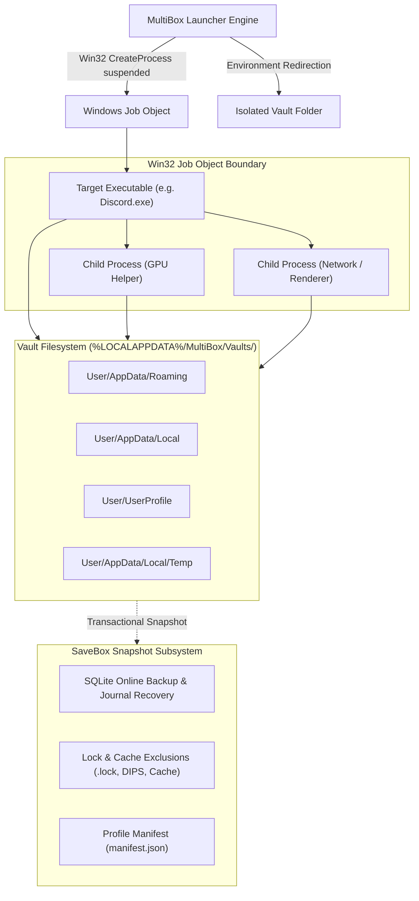

# MultiBox Architecture & Technical Internals ⚙️

This document describes the underlying architecture, low-level Win32 integration, process containment, and snapshot mechanics used by MultiBox.

---

## 🏛️ System Overview

MultiBox provides user-mode isolation for Windows applications without requiring administrative privileges, virtualization hypervisors, or custom kernel drivers.

---

## 1. Process Isolation: Win32 Job Objects

Instead of relying on executable filename matching (which fails when multiple copies of `chrome.exe` or `Discord.exe` run simultaneously), MultiBox assigns every session a dedicated **Windows Job Object** (`Core/JobObject.cs`).

- **Creation**: The job is created via `CreateJobObjectW` and configured with `JOB_OBJECT_LIMIT_KILL_ON_JOB_CLOSE` (optional) and process grouping attributes.
- **Process Enrollment**: When MultiBox launches an application, the initial process is assigned to the Job Object before its primary thread starts executing.
- **Child Process Tracking**: Windows automatically associates all child processes, renderers, GPU helpers, and crash reporters spawned by the application with the same Job Object.
- **Process ID Enumeration**: The engine queries `QueryInformationJobObject` with `JobObjectBasicProcessIdList` to retrieve the exact set of PIDs belonging to that specific instance. Window focusing, CPU monitoring, and graceful termination target this exact list.

---

## 2. Storage & Vault Isolation

Each session is allocated a private, isolated storage vault located in:
`%LOCALAPPDATA%\MultiBox\Vaults\<Session-GUID>\`

### Environment Variable Redirection
The application process inherits a customized environment block where Windows standard storage variables are redirected:
- `APPDATA` $\rightarrow$ `<Vault>\User\AppData\Roaming`
- `LOCALAPPDATA` $\rightarrow$ `<Vault>\User\AppData\Local`
- `USERPROFILE` $\rightarrow$ `<Vault>\User`
- `TEMP` / `TMP` $\rightarrow$ `<Vault>\User\AppData\Local\Temp`

### Command-Line Profile Arguments
For Chromium, Electron, and Gecko applications that maintain explicit command-line profile flags, MultiBox automatically detects the executable type and injects the corresponding argument:
- **Chromium / Electron**: `--user-data-dir="<Vault>\User\AppData\Local\<AppName>\User Data"`
- **Mozilla Firefox / Gecko**: `-profile "<Vault>\User\AppData\Roaming\Mozilla\Firefox\Profiles\default"`

### Junction & Symlink Safety
Directory cleanup (`Core/VaultRecovery.cs`) inspects NTFS reparse points before deletion. Junctions and symbolic links are unlinked rather than traversed, guaranteeing that host user folders outside the vault can never be deleted during a wipe.

---

## 3. SaveBox: Hot Profile Snapshots & SQLite WAL Consistency

Traditional file-copying tools fail when backing up modern desktop applications because active apps hold exclusive locks on SQLite databases and index files. SaveBox resolves this through a multi-stage snapshot protocol (`Core/LiveProfileSnapshot.cs`):

1. **Graceful Quiescence**: MultiBox sends standard `WM_CLOSE` messages to all top-level windows belonging to the session's Job Object and gives the app time to flush state.
2. **SQLite Online Backup API**: For SQLite databases containing conversation histories, cookies, and local state, MultiBox uses Microsoft's SQLite online backup API to stream committed pages directly from the write-ahead log (WAL) without copying half-written temporary journals.
3. **Smart Lock & Cache Exclusions**:
   - Skips locked temporary installer markers (`*.lock`, `sqlite-maintenance.lock`).
   - Bypasses browser cache directories (`Cache`, `Code Cache`, `GPUCache`).
   - Ignores Chromium's exclusively held bounce-tracking databases (`DIPS`, `declarative_performance_observer.db`), allowing them to regenerate cleanly on restore.
4. **Manifest Generation**: Generates `manifest.json` detailing the original application path, session timestamps, and profile metadata for 1-click restoration into a fresh vault.

---

## 4. UI Architecture: WebView2 & Native Host Composition

MultiBox's interface pairs Microsoft Edge WebView2 with native Windows Forms:
- **Frameless Glass Window**: The window uses `WS_POPUP` with Windows Desktop Window Manager (DWM) rounded corners (`DwmSetWindowAttribute(DWMWA_WINDOW_CORNER_PREFERENCE)`).
- **DirectMessage IPC Bridge**: Communication between HTML/JavaScript and C# occurs via `window.chrome.webview.postMessage` and is strictly validated against trusted local origins (`CoreWebView2_WebMessageReceived`).
- **High-FPS Motion Composition**:
  - Windows multimedia timer resolution is increased via `timeBeginPeriod(1)`.
  - An internal easing timer runs at up to ~80-120 FPS, animating the window `Location` with a cubic ease-out curve (`1 - (1 - t)^3`) over ~240ms.
  - Minimizing performs an ease-in quadratic slide towards the taskbar and seamlessly calls `ShowWindow(SW_HIDE)` to unregister from the Windows taskbar.
  - Restoring reverses the motion, smoothly emerging from the taskbar tray coordinates.

---

## 5. Security & Authenticode Signing

- **Mark-of-the-Web (Zone.Identifier)**: Downloaded executables automatically unblock themselves on first launch via Win32 `DeleteFileW(exePath + ":Zone.Identifier")`.
- **PE Attribute Certificate Table**: The standalone executable is signed with standard Windows Authenticode (`WIN_CERTIFICATE`), satisfying Windows Defender and SmartScreen integrity checks.
- **In-App Trust Escalation**: Provides a 1-click self-signed root installation via Windows CryptoAPI (`CertAddCertificateContextToStore`), permanently eliminating publisher warnings for offline or internal deployments.
