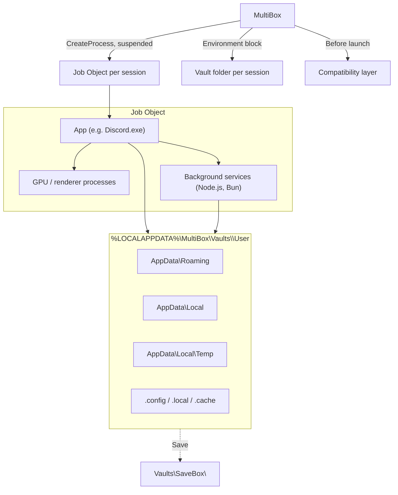

# MultiBox Architecture

> **Author**: [zer0ne](https://github.com/uranrog-01) · **Platform**: Windows 10 / 11 (x64) · **Runtime**: .NET 10, single-file

How MultiBox starts apps in separate sessions, keeps their data apart, saves profiles and handles apps that normally refuse a second copy. For the user guide, see the [README](README.md).

## Contents

1. [Overview](#overview)
2. [Process containment: Job Objects](#1-process-containment-job-objects)
3. [Storage redirection: the Vault](#2-storage-redirection-the-vault)
4. [App compatibility layer](#3-app-compatibility-layer)
5. [SaveBox: saving and restoring profiles](#4-savebox-saving-and-restoring-profiles)
6. [User interface](#5-user-interface)
7. [Security notes](#6-security-notes)
8. [Limitations](#7-limitations)

---

## Overview

MultiBox runs in user mode. It needs no administrator rights, kernel drivers or hypervisor.

---

## 1. Process containment: Job Objects

Every session owns one Windows Job Object (`Core/JobObject.cs`).

- **Created suspended**: the app is started with `CREATE_SUSPENDED`, assigned to the job, then resumed. Even very fast child processes therefore start inside the job.
- **Child processes**: renderers, GPU helpers, crash reporters and detached Node.js/Bun services inherit the job automatically.
- **Process list**: `QueryInformationJobObject(JobObjectBasicProcessIdList)` returns the session's exact process IDs. Window focus, telemetry and closing use this list, never executable names, so two copies of the same `.exe` never mix.
- **Cleanup**: the job is created with `JOB_OBJECT_LIMIT_KILL_ON_JOB_CLOSE`, so closing a session ends its whole process tree.

---

## 2. Storage redirection: the Vault

Each session gets a private folder: `%LOCALAPPDATA%\MultiBox\Vaults\<12-character id>\`.

### Environment variables

| Variable | Points to |
| :--- | :--- |
| `USERPROFILE`, `HOME`, `HOMEDRIVE` + `HOMEPATH` | `<Vault>\User` |
| `APPDATA` | `<Vault>\User\AppData\Roaming` |
| `LOCALAPPDATA` | `<Vault>\User\AppData\Local` |
| `TEMP`, `TMP` | `<Vault>\User\AppData\Local\Temp` |
| `XDG_CONFIG_HOME`, `CHROME_CONFIG_HOME` | `<Vault>\User\.config` |
| `XDG_DATA_HOME` | `<Vault>\User\AppData\Local` |
| `XDG_STATE_HOME`, `XDG_CACHE_HOME` | `<Vault>\User\.local\state`, `<Vault>\User\.cache` |

Windows resolves the *Roaming AppData*, *Local AppData*, *Documents*, *Desktop* and *Downloads* known folders from these variables, in both 64-bit and 32-bit (WOW64) processes. This was verified with `SHGetKnownFolderPath`, Node.js `os.homedir()`/`os.tmpdir()` and Bun.

### Profile arguments

| Engine | Detected by | Argument added |
| :--- | :--- | :--- |
| Chromium / Electron | `resources\app.asar`, `chrome.dll`, `ffmpeg.dll`, or the exe name | `--user-data-dir="<Vault>\User\AppData\Roaming\<ExeName>" --no-first-run --no-default-browser-check` |
| Firefox / Thunderbird | exe name | `-profile "<Vault>\User\AppData\Local\UserData" -no-remote` |

Electron apps that choose their own folder with `app.setPath('userData')` (for example OpenCode's `ai.opencode.desktop`) still land inside the Vault, because Electron derives `appData` from the redirected known folder.

### Safe deletion

`Core/VaultRecovery.cs` checks NTFS reparse points before deleting. Junctions and symbolic links are unlinked, never followed, so a wipe can't delete folders outside the Vault.

---

## 3. App compatibility layer

Some apps collide with their first copy through resources that environment variables can't redirect. `Core/AppCompatibility.cs` runs before each launch:

| Problem | Affected apps | Fix |
| :--- | :--- | :--- |
| **Named single-instance mutex.** A second copy finds the mutex, sends its arguments to the open window and exits. | Tauri apps (`<identifier>-sim`, e.g. Cline), apps using `single-instance` mutex names | `SingleInstanceLocks` finds other running copies of the **same executable path**, reads their mutex names (`NtQuerySystemInformation` + `NtQueryObject`) and closes only names that match single-instance conventions (`DuplicateHandle` with `DUPLICATE_CLOSE_SOURCE`). Other mutexes are not touched. Works for 32-bit and 64-bit targets. |
| **Fixed localhost service port.** | OpenCode Desktop (`opencode-cli serve --service`, port 45278) | Writes a free per-session port to `<Vault>\User\.config\opencode\service.json` (the file `opencode service set port` uses) and removes the stale service registration from restored profiles. |
| | Cline (hub daemon, port 25463) | Sets `CLINE_HUB_PORT` to a free per-session port. Without it, the copy would attach to, or fail against, the host's hub. |
| **Shared WebView2 data folder.** | WebView2 apps that never set a data folder (`<exe>.WebView2` next to the exe) | Sets `WEBVIEW2_USER_DATA_FOLDER` into the Vault. Apps that choose their own folder (Tauri's `EBWebView`) already follow the Vault and are left alone. |
| **Packaged apps.** | Microsoft Store desktop apps (`WindowsApps`), e.g. Codex, Claude | Started by path like any other app. If Windows denies the start, MultiBox explains that instead of showing "Access is denied". |

Ports are chosen from a fixed range, stay stable per session while free, and are never handed to two sessions at once.

### Runtime summary

| Runtime | Profile data | Second copy |
| :--- | :--- | :--- |
| Node.js | `os.homedir()`, `os.tmpdir()`, `%APPDATA%` → Vault | ✅ |
| Bun (incl. single-file executables) | Same as Node.js; spawned children inherit the Vault | ✅ |
| Electron | `userData`, single-instance lock keyed on it → Vault | ✅ |
| Tauri | Data via known folders → Vault; mutex released | ✅ |
| WebView2 | App-chosen folder → Vault; default folder redirected | ✅ |
| Win32 / WOW64 | Known folders → Vault; registry shared | ⚠️ |

---

## 4. SaveBox: saving and restoring profiles

A running app holds locks on its databases, so SaveBox uses a **close, save, reopen** cycle (`IsolationEngine.SaveProfileAndReopen`):

1. **Close**: `CloseMainWindow` is sent to every process in the job. If a window stays open (for example an unsaved-work prompt), the save stops and nothing is changed. Remaining background processes in the session's job are then ended.
2. **Copy** (`Core/LiveProfileSnapshot.cs`), into a staging folder:
   - SQLite databases are copied with the **online backup API** and saved as standalone files (`journal_mode=DELETE`), never as a database plus a stray WAL.
   - LevelDB folders are checked before and after copying; a change during the copy causes a retry.
   - Skipped: lock and marker files (`SingletonLock`, `lockfile`, `parent.lock`, …), regenerated stores (`DIPS`, `declarative_performance_observer.db`) and **cache folders** (`Cache`, `Code Cache`, `GPUCache`, `DawnCache`, …). Caches are recognized by layout inside any Chromium/Electron/WebView2 profile, not only the exe-named one.
   - Generated runtimes are skipped too, such as OpenCode's ~200 MB staged CLI under `ai.opencode.desktop\cli`, which the app restores itself.
3. **Commit**: the staging folder replaces the profile atomically; the old copy is kept as a backup until the move succeeds.
4. **Reopen**: the app restarts in the same session.

**Restore** copies the profile into a fresh Vault, rewrites stored Vault paths in text files and SQLite databases (`Core/PathMigrationHelper.cs`), and removes files Chromium must rebuild for a new path (`Secure Preferences`, `Web Data`, singleton locks). A profile opened from SaveBox stays **linked**: when its session closes, changes sync back with the same exclusions.

Each profile folder holds `Data\` and a `manifest.json` with the app path, save time, size and original Vault path.

---

## 5. User interface

- **WebView2 + Windows Forms**: the UI is local HTML in a frameless window with DWM rounded corners (`DWMWA_WINDOW_CORNER_PREFERENCE`).
- **Message bridge**: `chrome.webview.postMessage` messages are accepted only from the packaged UI page. Other navigations and new windows are blocked.
- **Tray motion**: `timeBeginPeriod(1)` enables a high-rate timer; the window slides with a cubic ease-out (`1 - (1 - t)^3`, about 240 ms) and is hidden from the taskbar when docked.
- **Window marking**: a colored border and label follow the selected session's windows.

---

## 6. Security notes

- **Mark-of-the-Web**: on start, MultiBox removes the `Zone.Identifier` stream from its own files (`DeleteFileW(path + ":Zone.Identifier")`) so extracted DLLs load without prompts.
- **Code signing**: releases are signed with a self-signed certificate (`CN=zer0ne`). Windows treats it as an unknown publisher, so SmartScreen warns on first run.
- **Handle closing** (section 3) is limited to processes with the identical executable path, running as the same user, and to mutex names matching single-instance patterns.

---

## 7. Limitations

MultiBox separates **profiles**. It is not a security boundary.

- **Registry**: `HKEY_CURRENT_USER` is shared. Apps that keep settings or accounts in the registry share them between copies.
- **Credential Manager / DPAPI vault**: shared per Windows user. Apps that keep tokens there (for example via `keytar`) may share a login.
- **Folders not driven by environment variables**: `AppData\LocalLow` and the *Profile* known folder (Electron `app.getPath('home')`, Rust `dirs::home_dir`) point to your real profile.
- **File and network access** are not restricted.
- **Other single-instance methods**, such as named pipes, fixed ports in other apps or window-class checks, are handled only for the apps listed in section 3.
