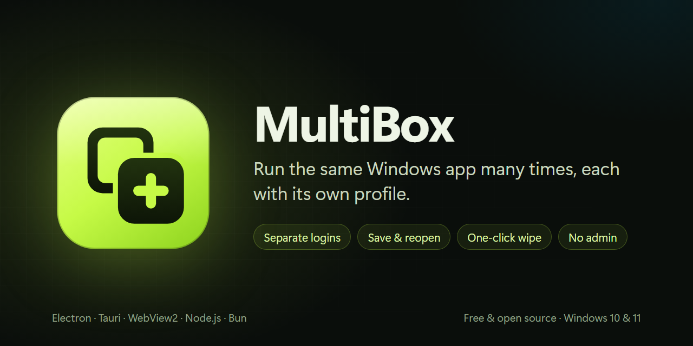
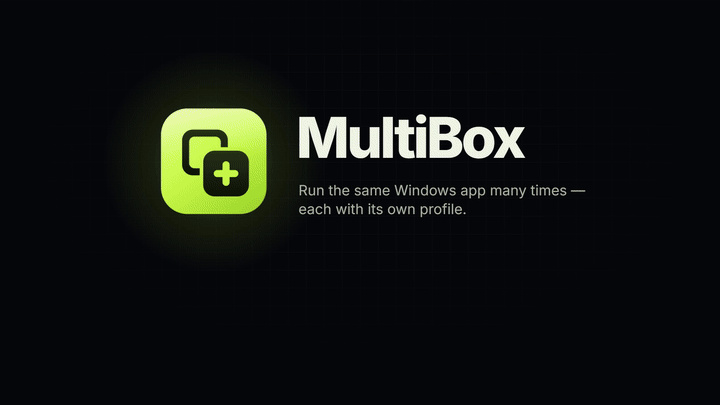
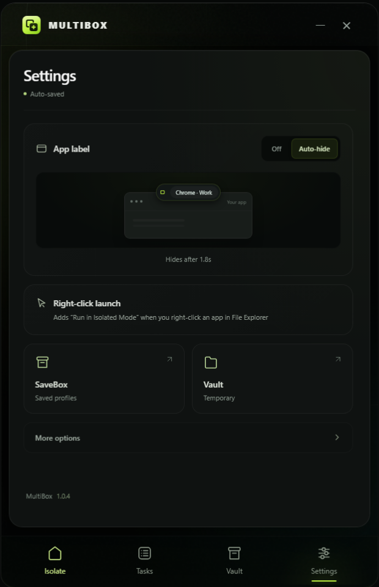

<div align="center">


# MultiBox

**Run the same Windows app many times, each copy with its own profile.**

Separate logins, cookies and settings for every copy. Save the copies you want to keep, wipe the rest with one click.

[](https://github.com/uranrog-01/MultiBox/releases/latest)
[](https://uranrog-01.github.io/MultiBox/)
[](#requirements)
[](https://github.com/uranrog-01/MultiBox/actions/workflows/build.yml)
[](LICENSE)



</div>

## Contents

- [See it in action](#see-it-in-action)
- [What it does](#what-it-does)
- [Quick start](#quick-start)
- [How to use](#how-to-use)
- [Compatibility](#compatibility)
- [What is not separated](#what-is-not-separated)
- [FAQ & troubleshooting](#faq--troubleshooting)
- [Build from source](#build-from-source)
- [How it works](#how-it-works)
- [Contributing & support](#contributing--support)
- [License](#license)

## See it in action

<div align="center">

[](https://uranrog-01.github.io/MultiBox/#intro)

**[▶ Watch the full 30-second intro with sound](https://uranrog-01.github.io/MultiBox/#intro)** · [Download the MP4](docs/assets/MultiBox-Intro.mp4)

</div>

## What it does

Most desktop apps (Discord, Slack, VS Code, Chrome and many others) keep one profile per Windows user. To use a second account, you sign out and sign back in. MultiBox removes that step: every copy you open runs in its own **session** with its own data folders, so several accounts can run side by side.

| | Without MultiBox | With MultiBox |
| :--- | :--- | :--- |
| Second copy of an app | Often blocked, or opens the existing window | Opens as a separate copy |
| Logins & cookies | Shared by every window | Separate for every copy |
| Switching accounts | Sign out, sign in | Keep both open |
| Leftover data | Stays on disk | **Wipe** deletes the session's files |
| Keeping a setup | Copy profile folders by hand | **Save** it as a named profile |

MultiBox needs no admin rights, drivers or virtual machine. It is portable: one folder, no installer.

## Quick start

1. Download the latest **`MultiBox-v…-win-x64.zip`** from [Releases](https://github.com/uranrog-01/MultiBox/releases/latest).
2. Extract it anywhere and run **`MultiBox.exe`**.
3. Drag an app's `.exe` or shortcut onto MultiBox, then click **Another copy** for each extra copy.

> [!NOTE]
> The first run may show a Windows SmartScreen warning. Click **More info → Run anyway**. [Why?](#faq--troubleshooting)

## How to use

| Step | What to do |
| :--- | :--- |
| **Add an app** | Drag an `.exe` or desktop shortcut onto MultiBox, or click **Browse**. It opens in a fresh, empty profile. |
| **Open more copies** | Click **Another copy**. Each copy is a separate session you can sign in to with a different account. |
| **Switch & label** | Pick a session at the top of the window. Use **Name & color** to label it (for example *Chrome · Work*). A colored border marks isolated windows. |
| **Keep a copy** | Click **Save** and enter a name. MultiBox closes the app briefly, copies its data, then reopens it. |
| **Reopen a saved profile** | Open **Vault → Saved** and click **Open**. The profile starts in a fresh session and stays up to date when you close the app. |
| **Clean up** | Click **Wipe** to close a session and delete its temporary files. Saved profiles are kept. |
| **Launch from Explorer** | Turn on **Settings → Right-click launch**, then right-click any `.exe` or shortcut and choose **Run in Isolated Mode (MultiBox)**. |
| **Copy a running program** | Open **Tasks** and click **Isolate & Run** on any running program to start a separate copy of it. |

Closing or minimizing MultiBox sends it to the system tray. Click the tray icon to bring it back; right-click it to quit.

### Screenshots

| Main window | Saved profiles |
| :---: | :---: |
|  |  |
| **Tasks** | **Settings** |
|  |  |

## Compatibility

| App type | Examples | Status |
| :--- | :--- | :--- |
| Electron | Discord, Slack, VS Code, OpenCode | ✅ Own profile per copy |
| Chromium browsers | Chrome, Edge, Brave | ✅ Own `--user-data-dir` per copy |
| Tauri | Cline | ✅ Tauri's single-instance lock is released, so a real second copy opens |
| WebView2 apps | Apps built on Edge WebView2 | ✅ Own WebView2 data per copy |
| Node.js & Bun | Bundled CLIs and background services | ✅ Own home, temp and XDG folders per copy. OpenCode and Cline get their own service ports. |
| Firefox & Thunderbird | Mozilla apps | ✅ Own `-profile` with `-no-remote` |
| Classic Win32 apps | 32-bit and 64-bit | ⚠️ Works when the app stores data in AppData. Registry settings are shared. |
| Microsoft Store desktop apps | Codex (ChatGPT), Claude | ✅ Start from their `WindowsApps` folder like any other app |

## What is not separated

MultiBox separates app **profiles**. It is **not a security sandbox**: apps run with your normal permissions and can read your files. These are shared between copies:

- The registry (`HKEY_CURRENT_USER`)
- Windows Credential Manager. Apps that keep sign-in tokens there may share a login.
- `AppData\LocalLow` and the Windows *Profile* folder, as returned by Electron's `app.getPath('home')` or Rust's `dirs::home_dir`
- Your network connection and IP address

To run untrusted software, use a virtual machine or Windows Sandbox instead.

## FAQ & troubleshooting

<details>
<summary><b>Why does Windows show a SmartScreen warning?</b></summary>

Releases are signed with a self-signed certificate (`CN=zer0ne`), which Windows does not recognize as a known publisher. Click **More info → Run anyway**, or [build MultiBox yourself](#build-from-source).
</details>

<details>
<summary><b>An app opened my existing window instead of a new copy.</b></summary>

Some apps allow only one running copy and send new launches to the open window. MultiBox handles Electron/Chromium profile locks and Tauri's single-instance lock. If an app still does this, [open an issue](https://github.com/uranrog-01/MultiBox/issues) with the app's name and version.
</details>

<details>
<summary><b>OpenCode shows "Managed service port 45278 is already in use".</b></summary>

OpenCode Desktop runs a background service on a fixed port, so a second copy collided with the first. MultiBox 1.0.4 and later give every copy its own port. Update to the latest release.
</details>

<details>
<summary><b>Does Save interrupt my app?</b></summary>

Briefly. Save asks the app to close, copies its data consistently, then reopens it in the same session. If the app has unsaved work or an open dialog, Save stops and asks you to finish first. Nothing is deleted.
</details>

<details>
<summary><b>Where are my files?</b></summary>

Sessions: `%LOCALAPPDATA%\MultiBox\Vaults`. Saved profiles: `%LOCALAPPDATA%\MultiBox\Vaults\SaveBox`. The Vault panel has buttons to open both folders.
</details>

## Requirements

- Windows 10 or 11, 64-bit
- Nothing else for the release build: the .NET runtime is included. Microsoft Edge WebView2 Runtime is preinstalled on current Windows.

## Build from source

Requires the [.NET 10 SDK](https://dotnet.microsoft.com/download).

```powershell
git clone https://github.com/uranrog-01/MultiBox.git
cd MultiBox
dotnet build -c Release

# Single-file, self-contained build
dotnet publish -c Release -r win-x64 --self-contained true -p:PublishSingleFile=true -o ./publish
```

Run the native integration tests:

```powershell
dotnet build tests/SessionFixture -c Release
dotnet run --project tests/SessionTests -c Release -- tests/SessionFixture/bin/Release/net10.0-windows
```

## How it works

Each session starts the app suspended inside its own Windows **Job Object**, so every child process belongs to that session. The app's environment points `USERPROFILE`, `APPDATA`, `LOCALAPPDATA`, `TEMP` and the XDG folders at the session's Vault folder. Chromium, Electron and Firefox also get explicit profile flags. **SaveBox** copies SQLite databases with the online backup API and skips caches and lock files.

Read the full [architecture guide](ARCHITECTURE.md).

## Contributing & support

- **An app doesn't work?** Use the [app compatibility form](https://github.com/uranrog-01/MultiBox/issues/new?template=app_compatibility.yml).
- **Found a bug or have an idea?** [Open an issue](https://github.com/uranrog-01/MultiBox/issues/new/choose).
- **Security problem?** Please report it privately: see [SECURITY.md](SECURITY.md).
- **Want to help?** See [CONTRIBUTING.md](CONTRIBUTING.md). What changed in each version: [CHANGELOG.md](CHANGELOG.md).

## License

[MIT](LICENSE) © 2026 [zer0ne](https://github.com/uranrog-01)
