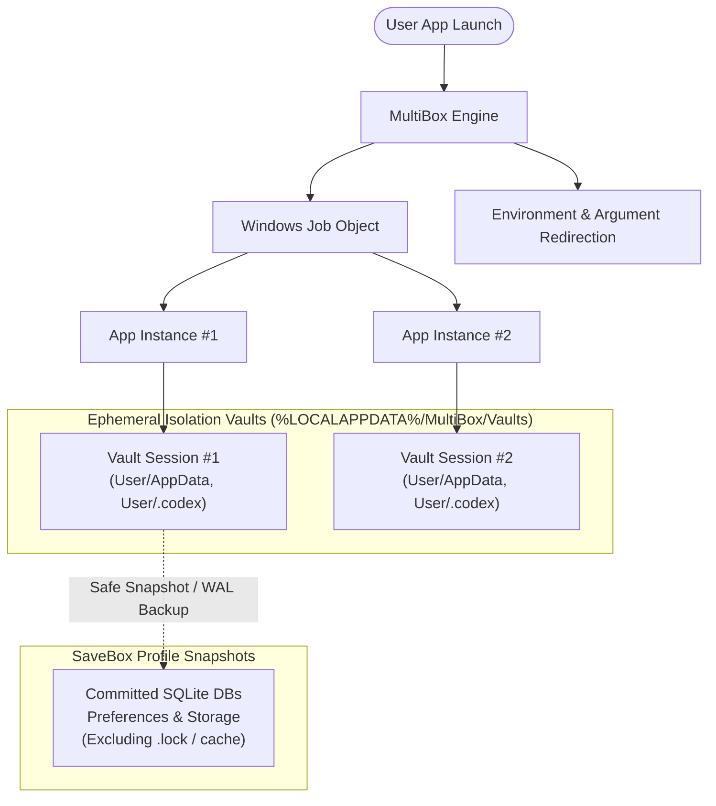

# MultiBox 🛡️

[](https://opensource.org/licenses/MIT)
[](https://microsoft.com/windows)
[](https://dotnet.microsoft.com/)
[]()
[](https://github.com/uranrog-01)

> **Lightweight Windows launcher for running multiple independent app sessions concurrently. One unified dashboard switches between active sessions without restarting them.**

---

## ✨ Features

- **🔄 Isolated Concurrent Sessions**: Launch multiple independent copies of Chromium/Electron apps (Slack, Discord, VS Code, OpenAI Codex, Chrome, Edge) with separate profile directories, cache vaults, and environment variables.
- **⚡ System Tray Flyout & Motion**: MultiBox docks neatly into the system tray. Minimizing slides the window gracefully into the notification area, while launching or restoring slides the window smoothly into view from the system tray.
- **💾 SaveBox Profile Snapshots**: Save, name, and swap profiles (e.g., *Work* vs. *Personal*) for any running app. Uses online SQLite WAL database backups, transactional consistency, and excludes locked temp files.
- **🛡️ Process Tree Tracking**: Uses native Windows Job Objects to manage child processes and window focus without requiring kernel drivers or administrator rights.
- **🔕 Non-Intrusive App Pill**: A sleek 208×26px auto-hiding indicator pill shows which session you are currently operating without drawing borders or capturing clicks.
- **🔒 Authenticode Signed & SmartScreen Friendly**: Ships with automated Mark-of-the-Web unblocking and a built-in 1-click publisher trust action right inside the app settings.

---

## 🚀 Quick Start

### 1. Download
Download the latest pre-built package `MultiBox-v1.0.3-win-x64.zip` from [**GitHub Releases**](https://github.com/uranrog-01/MultiBox/releases).

### 2. Run
Extract the archive and double-click `MultiBox.exe`.

> **Note on Windows SmartScreen**:
> MultiBox is signed with an Authenticode certificate issued by `zer0ne`. If Windows displays an "Unknown Publisher" warning on initial download:
> - Click **"More info" → "Run anyway"**
> - Or open MultiBox Settings (⚙️) and click **"Trust Publisher on this PC"** for permanent 1-click trust with zero future prompts.

---

## 📖 How to Use

- **New Session**: Drag and drop any `.exe` or application shortcut directly onto the MultiBox dashboard, or select one from the running process list.
- **Multiple Copies**: Click **Another copy** to spawn a fresh, parallel instance of the currently selected app with an independent vault.
- **Session Capsules**: Click capsules (e.g., *Discord #1*, *Discord #2*) to switch telemetry, inspect health, or focus windows.
- **Names & Colors**: In **Vault → Apps**, customize your session label (e.g. *Client A*, *Personal*) and assign one of 6 accent colors.
- **Save Profiles**: Go to **Vault → Apps** and click **Save**. Enter a profile name and choose **Save & reopen** to preserve your setup in SaveBox.
- **Restore Profiles**: In **Vault → Saved**, launch any saved profile as a new, independent session.
- **End & Wipe**: Close a session and immediately purge its ephemeral cache and temporary files by clicking **End & wipe**.
- **Minimize to Tray**: Click the minimize (`_`) or close (`X`) button in the titlebar. MultiBox slides down into the system tray. Click the tray icon to slide it back out.

---

## 🏗️ Architecture & Isolation Model



### What Separation Means
MultiBox redirects user-mode profile paths (`APPDATA`, `LOCALAPPDATA`, `USERPROFILE`) and supplies command-line profile arguments for Chromium, Electron, and Gecko applications. 
- Windows Job Objects govern process trees, tracking all child processes cleanly for window activation and atomic cleanup.
- This provides **profile and credential separation** for multitasking and privacy; it is not a virtualization boundary or kernel air-gap against malicious software.
- Cleanup purges only the target session folder without traversing directory junctions into host system files.

---

## 🛠️ Building from Source

### Prerequisites
- Windows 10 (1809+) or Windows 11 (x64)
- [.NET 10 SDK](https://dotnet.microsoft.com/)
- [Microsoft Edge WebView2 Runtime](https://developer.microsoft.com/en-us/microsoft-edge/webview2/) (pre-installed on Windows 10/11)

### Build Commands

```powershell
# Clone the repository
git clone https://github.com/uranrog-01/MultiBox.git
cd MultiBox

# Build Debug / Development
dotnet build -c Release

# Publish Single-File Self-Contained Binary
dotnet publish -c Release -r win-x64 --self-contained true -p:PublishSingleFile=true -o ./publish
```

---

## 🧪 Verification & Automated Testing

MultiBox includes a comprehensive native test harness with 26 integration checks covering atomic Job Objects, multi-process handoff, SQLite WAL recovery, junction traversal safety, concurrent instances, and crash recovery.

```powershell
# Build test fixture
dotnet build tests/SessionFixture -c Release

# Run automated integration test suite
dotnet run --project tests/SessionTests -c Release -- tests/SessionFixture/bin/Release/net10.0-windows
```

In addition, browser UI tests in `design/verify-*.cjs` validate sliding panels, session identity, telemetry graphs, and compact layout responsiveness.

---

## 📄 License

This project is licensed under the **MIT License** - see the [LICENSE](LICENSE) file for details.

Copyright © 2026 **zer0ne** ([https://github.com/uranrog-01](https://github.com/uranrog-01))
