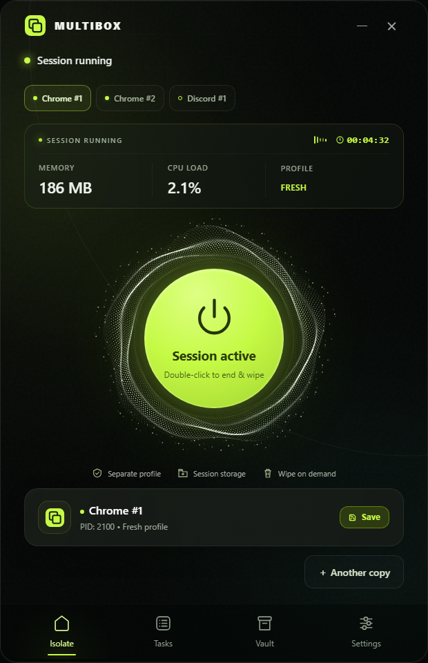
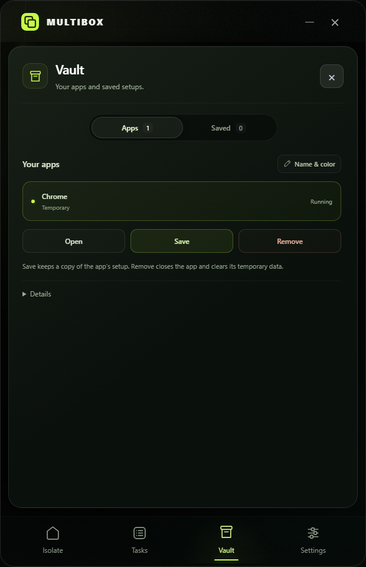
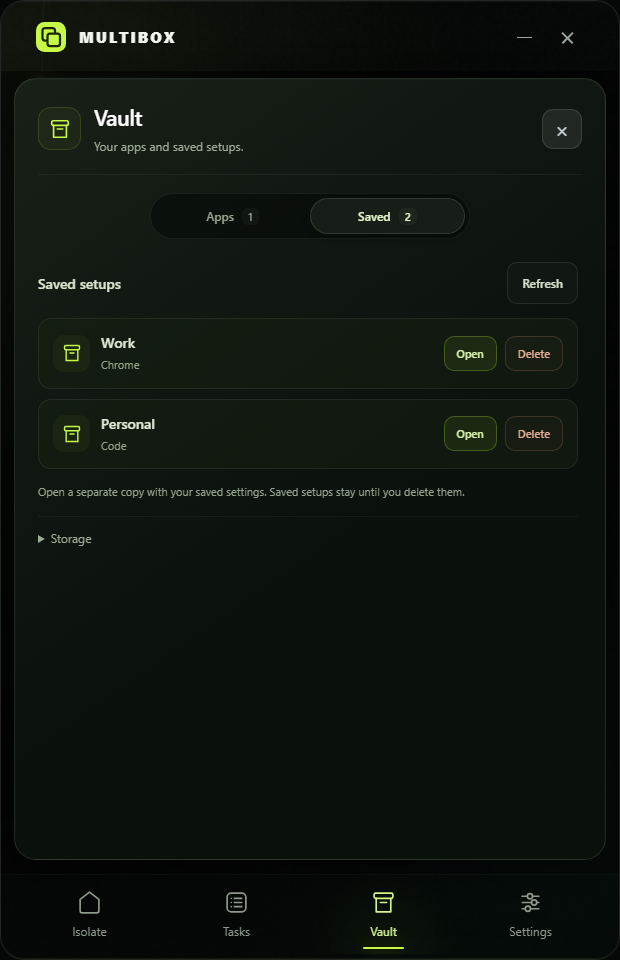
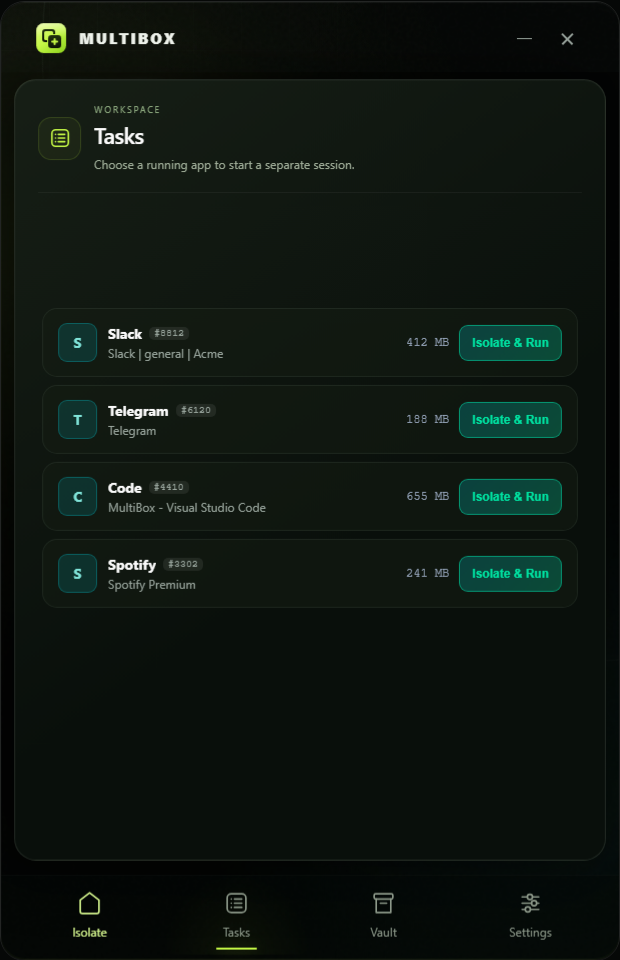

<div align="center">

<a href="https://github.com/uranrog-01">
  
</a>

<p align="center">
  <a href="https://github.com/uranrog-01/MultiBox">
    
  </a>
</p>

# MultiBox

### **Run any Windows app multiple times concurrently — 100% isolated.**

*Architected & Created by [**zer0ne**](https://github.com/uranrog-01) — No shared logins. No shared cookies. Brand-new PC environment for every instance.*

---

[](https://uranrog-01.github.io/MultiBox/)
[](https://opensource.org/licenses/MIT)
[](https://microsoft.com/windows)
[](https://dotnet.microsoft.com/)
[]()
[](https://github.com/uranrog-01/MultiBox/releases/latest)
[](https://github.com/uranrog-01)

<br/>

| ⚡ Instant Multi-Session | 🔒 Zero Cross-Talk | 💾 SaveBox Snapshots | 🗄️ 1-Click Vault Wipe | 🪟 Tray Slide Motion |
|:---:|:---:|:---:|:---:|:---:|

</div>

---

## 💡 Why MultiBox?

Normally, Windows and desktop apps (like **Discord, Telegram, Slack, Chrome, WhatsApp, Edge, and VS Code**) restrict you to a single instance or force every window to share the exact same user profile, cookies, and login credentials.

**MultiBox breaks this limitation seamlessly.**

It acts as an on-demand application container: every copy you launch is placed in its own private sandbox. You can run **5 Discord accounts**, **3 WhatsApp windows**, or **independent browser testing environments** simultaneously with complete isolation.

### Standard Windows vs. MultiBox

| Standard Windows | With MultiBox 🛡️ |
| :--- | :--- |
| ❌ Blocks launching a 2nd copy of the app | ✅ **Launch unlimited parallel copies** |
| ❌ All windows share one login and cache | ✅ **Each instance gets its own brand-new profile** |
| ❌ Must log out and log in to switch accounts | ✅ **All your accounts run side-by-side** |
| ❌ Leaves persistent cookies and cache on disk | ✅ **1-Click Wipe removes temporary traces instantly** |
| ❌ Tedious setup with complex command-line flags | ✅ **Simple drag-and-drop launcher with tray flyout** |

---

## 📸 Visual Showcase

<div align="center">

| 🖥️ 1. Main Dashboard & Capsule Switcher | 🗄️ 2. The Vault (Isolated Sandboxes) |
|:---:|:---:|
|  |  |
| *Launch duplicate instances & switch instantly with capsules* | *Each app runs in its own sandbox with 1-click wipe* |

| 💾 3. SaveBox Profile Library | 📊 4. Tasks & Live Container Telemetry |
|:---:|:---:|
|  |  |
| *Save & swap permanent setups (Work, Personal, Clients)* | *Inspect active processes & isolate running apps* |

</div>

---

## 🎯 How It Works: The 3 Core Pillars

### 1. 🗄️ The Vault (Ephemeral Session Sandbox)
When you launch an application through MultiBox, it creates a private **Vault** folder on your computer.
- **Complete Redirection**: All user data, settings, login cookies, and local databases are contained inside that specific vault.
- **Instance Separation**: Instance #1 can never access or read data from Instance #2.
- **Instant Clean Wipe**: Click **End & wipe** to terminate the session and permanently erase its temporary files. Nothing lingers on your PC.

### 2. 💾 SaveBox (Permanent Profile Manager)
While temporary sessions are erased when closed, you often want to keep specific accounts permanently.
- **Save Setups**: In **Vault → Apps**, click **Save** on any running session. Give it a name like *Work Discord* or *Crypto Portfolio*.
- **Hot SQLite Backups**: SaveBox takes a transactional snapshot of the databases and cookies without requiring you to restart or lose unsaved progress.
- **1-Click Restore**: Under **Vault → Saved**, click any saved profile to launch it into a fresh, isolated session anytime.

### 3. 📊 Tasks & Real-Time HUD
- **Process Inspection**: Monitor exact memory, CPU usage, and process trees for every running container.
- **1-Click Program Capture**: Notice a program already open on your desktop? Click it in the Tasks list to immediately bring it into an isolated MultiBox container.
- **Telemetry Reactor**: Dynamic particle core and container pulse bars reflect live container activity.

---

## 🪟 System Tray Docking & Motion

MultiBox is designed to stay completely out of your way until you need it:

* **Slide to Minimize**: Clicking **Minimize (`_`)** or **Close (`X`)** glides the window smoothly down into the Windows system tray and hides it from your taskbar.
* **Fluid Slide-In Motion**: Clicking the tray icon or launching `MultiBox.exe` slides the window smoothly back out from the tray corner with a high-FPS cubic ease-out animation.
* **Quick Tray Menu**: Right-click the tray icon to quickly reopen, inspect container status, wipe all active sessions, or exit.

---

## 🚀 Quick Start Guide

### Step 1: Download
👉 [**Download `MultiBox-v1.0.3-win-x64.zip` (Latest Release)**](https://github.com/uranrog-01/MultiBox/releases/latest)

### Step 2: Extract & Launch
Extract the `.zip` archive anywhere on your PC and run **`MultiBox.exe`**.

> [!TIP]
> **Windows SmartScreen Note**:
> MultiBox is digitally signed with an Authenticode certificate by `zer0ne`. If Windows displays a first-run prompt:
> 1. Click **"More info" → "Run anyway"**.
> 2. *(Optional)* Open MultiBox Settings (⚙️) and click **"Trust Publisher on this PC"** for permanent 1-click trust with zero future prompts.

### Step 3: Start Multitasking!
- **Drag & drop** any executable (`.exe`) or desktop shortcut into MultiBox.
- Click **Another copy** to open a second isolated copy of that app.
- Click **Save** in Vault whenever you want to keep an account permanently!

---

## 🛠️ Building from Source

```powershell
# 1. Clone repository
git clone https://github.com/uranrog-01/MultiBox.git
cd MultiBox

# 2. Build Release (.NET 10 SDK required)
dotnet build -c Release

# 3. Publish standalone single-file binary
dotnet publish -c Release -r win-x64 --self-contained true -p:PublishSingleFile=true -o ./publish
```

To run the automated native test harness (26 integration checks):
```powershell
dotnet build tests/SessionFixture -c Release
dotnet run --project tests/SessionTests -c Release -- tests/SessionFixture/bin/Release/net10.0-windows
```

---

## 🔬 Deep Technical Architecture

MultiBox is powered by low-level **Windows Job Objects**, **SQLite Write-Ahead Logging (WAL) recovery**, dynamic environment block redirection, and Desktop Window Manager (DWM) composition.

For a comprehensive technical breakdown of the process containment models, security boundaries, and snapshot protocols:

👉 [**Read the Architecture & Technical Internals Guide (`ARCHITECTURE.md`)**](ARCHITECTURE.md)

---

## 👨‍💻 Creator & Author

<div align="center">

**MultiBox** is engineered and maintained by **[zer0ne](https://github.com/uranrog-01)**.

[](https://github.com/uranrog-01)
[](https://github.com/uranrog-01)
[](https://github.com/uranrog-01)

*Specializing in low-level Windows systems architecture, process containment, and high-performance native tooling.*

</div>

---

## 📄 License

This project is open-source and released under the **MIT License**.  
See the [LICENSE](LICENSE) file for complete terms.

Copyright © 2026 **zer0ne** ([https://github.com/uranrog-01](https://github.com/uranrog-01))
