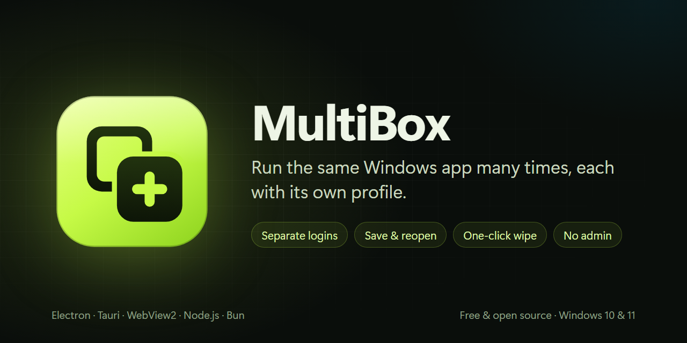
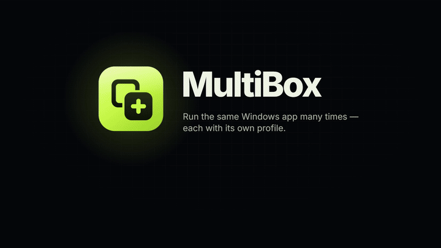
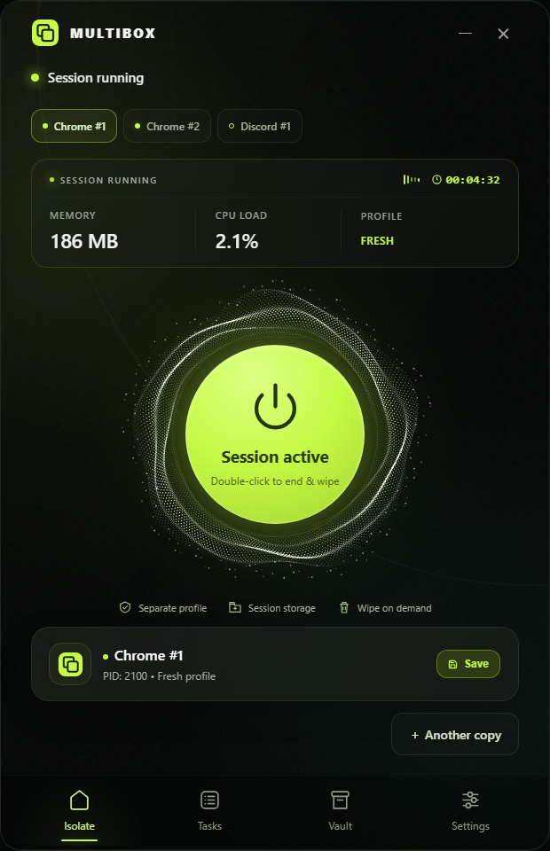
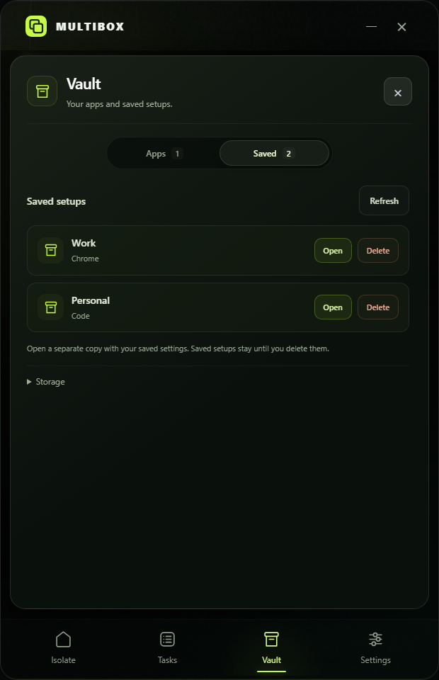
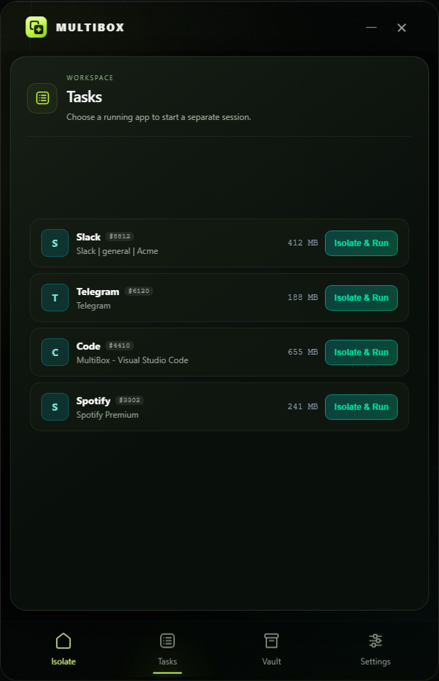
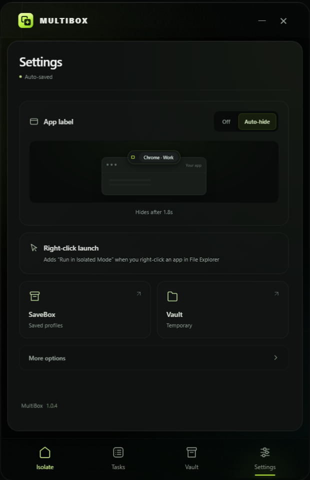

<div align="center">


# MultiBox

**Run the same Windows app many times, each copy with its own profile.**

Separate logins, cookies and settings for every copy. Save the copies you want to keep, wipe the rest with one click.

[](https://github.com/uranrog-01/MultiBox/releases/latest)
[](https://uranrog-01.github.io/MultiBox/)
[](#requirements)
[](https://github.com/uranrog-01/MultiBox/actions/workflows/build.yml)
[](LICENSE)



</div>

## Contents

- [See it in action](#see-it-in-action)
- [What it does](#what-it-does)
- [Quick start](#quick-start)
- [Install](#install)
- [How to use](#how-to-use)
- [Compatibility](#compatibility)
- [What is not separated](#what-is-not-separated)
- [FAQ & troubleshooting](#faq--troubleshooting)
- [Build from source](#build-from-source)
- [How it works](#how-it-works)
- [Contributing & support](#contributing--support)
- [License](#license)

## See it in action

<div align="center">

[](https://uranrog-01.github.io/MultiBox/#intro)

**[▶ Watch the full 30-second intro with sound](https://uranrog-01.github.io/MultiBox/#intro)** · [Download the MP4](docs/assets/MultiBox-Intro.mp4)

</div>

## What it does

Most desktop apps (Discord, Slack, VS Code, Chrome and many others) keep one profile per Windows user. To use a second account, you sign out and sign back in. MultiBox removes that step: every copy you open runs in its own **session** with its own data folders, so several accounts can run side by side.

| | Without MultiBox | With MultiBox |
| :--- | :--- | :--- |
| Second copy of an app | Often blocked, or opens the existing window | Opens as a separate copy |
| Logins & cookies | Shared by every window | Separate for every copy |
| Switching accounts | Sign out, sign in | Keep both open |
| Leftover data | Stays on disk | **Wipe** deletes the session's files |
| Keeping a setup | Copy profile folders by hand | **Save** it as a named profile |

MultiBox needs no admin rights, drivers or virtual machine. It is portable: one folder, no installer.

## Quick start

**Installer (recommended)** — download **`MultiBox-Setup-v…-win-x64.exe`** from [Releases](https://github.com/uranrog-01/MultiBox/releases/latest) and run it. One wizard installs MultiBox, adds shortcuts, and registers a proper uninstaller.

**Portable (no install)** — download the setup and extract it anywhere with `MultiBox-Setup-…-win-x64.exe --extract-to <folder>`, then run `MultiBox.exe` from that folder. Nothing is written outside it.

Then:

1. Drag an app's `.exe` or shortcut onto MultiBox, then click **Another copy** for each extra copy.
2. Sign in to each copy with a different account.
3. Name the ones you want to keep with **Save**; wipe the rest.

> [!NOTE]
> The first run may show a Windows SmartScreen warning. Click **More info → Run anyway**. [Why?](#faq--troubleshooting)

## Install

The setup is a single self-contained `.exe` with the whole app embedded — no separate download, no runtime to install first.

| | |
| :--- | :--- |
| **Installs to** | `%LocalAppData%\Programs\MultiBox` (per user) or `C:\Program Files\MultiBox` (all users) |
| **Creates** | Desktop shortcut, Start menu folder with an **Uninstall MultiBox** entry, an `Uninstall.exe` in the install folder, and a registration in **Settings → Apps → Installed apps** |
| **Upgrades** | Running a newer setup over an existing install updates it in place; your sessions are kept |
| **Sessions** | Live in `%LocalAppData%\MultiBox` and survive an uninstall unless you ask to remove them |

### Command line

Useful for scripted or unattended installs:

```powershell
MultiBox-Setup-v1.0.4-win-x64.exe                          # the wizard
MultiBox-Setup-v1.0.4-win-x64.exe --silent                 # install with defaults, no UI
MultiBox-Setup-v1.0.4-win-x64.exe --silent --install-to "D:\Tools\MultiBox"
MultiBox-Setup-v1.0.4-win-x64.exe --silent --all-users     # Program Files (needs an admin prompt)
MultiBox-Setup-v1.0.4-win-x64.exe --silent --no-desktop-shortcut --no-start-menu
MultiBox-Setup-v1.0.4-win-x64.exe --extract-to "D:\Portable"   # app files only, no shortcuts or registry
MultiBox-Setup-v1.0.4-win-x64.exe --version
MultiBox-Setup-v1.0.4-win-x64.exe --help
```

`--extract-to` is a clean portable unpack — it touches nothing else on the system.

### Uninstall

Uninstall from **Settings → Apps → Installed apps → MultiBox**, from the Start menu folder, by running the `Uninstall.exe` next to `MultiBox.exe`, or with `MultiBox.exe --uninstall`. They all open the same uninstaller, which asks before removing your sessions and profiles.

## How to use

| Step | What to do |
| :--- | :--- |
| **Add an app** | Drag an `.exe` or desktop shortcut onto MultiBox, or click **Browse**. It opens in a fresh, empty profile. |
| **Open more copies** | Click **Another copy**. Each copy is a separate session you can sign in to with a different account. |
| **Switch & label** | Pick a session at the top of the window. Use **Name & color** to label it (for example *Chrome · Work*). A colored border marks isolated windows. |
| **Keep a copy** | Click **Save** and enter a name. MultiBox closes the app briefly, copies its data, then reopens it. |
| **Reopen a saved profile** | Open **Vault → Saved** and click **Open**. The profile starts in a fresh session and stays up to date when you close the app. |
| **Clean up** | Click **Wipe** to close a session and delete its temporary files. Saved profiles are kept. |
| **Launch from Explorer** | Turn on **Settings → Right-click launch**, then right-click any `.exe` or shortcut and choose **Run in Isolated Mode (MultiBox)**. |
| **Copy a running program** | Open **Tasks** and click **Isolate & Run** on any running program to start a separate copy of it. |

Closing or minimizing MultiBox sends it to the system tray. Click the tray icon to bring it back; right-click it to quit.

### Screenshots

| Main window | Saved profiles |
| :---: | :---: |
|  |  |
| **Tasks** | **Settings** |
|  |  |

## Compatibility

| App type | Examples | Status |
| :--- | :--- | :--- |
| Electron | Discord, Slack, VS Code, OpenCode | ✅ Own profile per copy |
| Chromium browsers | Chrome, Edge, Brave | ✅ Own `--user-data-dir` per copy |
| Tauri | Cline | ✅ Tauri's single-instance lock is released, so a real second copy opens |
| WebView2 apps | Apps built on Edge WebView2 | ✅ Own WebView2 data per copy |
| Node.js & Bun | Bundled CLIs and background services | ✅ Own home, temp and XDG folders per copy. OpenCode and Cline get their own service ports. |
| Firefox & Thunderbird | Mozilla apps | ✅ Own `-profile` with `-no-remote` |
| Classic Win32 apps | 32-bit and 64-bit | ⚠️ Works when the app stores data in AppData. Registry settings are shared. |
| GoldSrc games (Half-Life) | hl.exe, Counter-Strike 1.6 | ✅ The launcher's one-instance mutex is released, the launcher runs inside the session (`-steam`, the argument Steam itself passes), and Steam is started automatically when it is missing. Real concurrent sessions verified; use windowed mode when a fullscreen copy owns the screen. |
| Service-brokered apps | Malwarebytes | ✅ Two windows run side by side when the second copy launches under a **different Windows account** — the app's single-instance pipe name embeds the user SID, so the accounts don't collide. Same account: MultiBox refuses with an explanation and a "Different user…" button instead of the confusing flash-and-close. The second copy's session data still goes into its Vault. |
| Steam client | steam.exe | ✅ A second client runs under a **different Windows account**: MultiBox gives it its own master IPC name (`-master_ipc_name_override`), so it starts instead of handing the launch to the open client, and the other account's profile keeps its own browser cache and Steam sign-in. Same account: refused with an explanation — the client's browser cache path is taken from the Windows account itself, not from the environment, so **no profile or Vault folder can change it**: a second UI would stay unresponsive and even a first one would take the cache from your own Steam. Games inside a Steam library (GoldSrc) launch normally per session. |
| Microsoft Store desktop apps | Codex (ChatGPT), Claude | ✅ Start from their `WindowsApps` folder. Codex/ChatGPT browse the real Windows profile; their account and session data stay in the Vault. |

## What is not separated

MultiBox separates app **profiles**. It is **not a security sandbox**: apps run with your normal permissions and can read your files. These are shared between copies:

- The registry (`HKEY_CURRENT_USER`)
- Windows Credential Manager. Apps that keep sign-in tokens there may share a login.
- `AppData\LocalLow` and the Windows *Profile* folder, as returned by Electron's `app.getPath('home')` or Rust's `dirs::home_dir`. Codex/ChatGPT intentionally use this real profile for **Open Folder** and shell home; their account, session and browser data are still vaulted.
- Your network connection and IP address

To run untrusted software, use a virtual machine or Windows Sandbox instead.

## FAQ & troubleshooting

<details>
<summary><b>Why does Windows show a SmartScreen warning?</b></summary>

Releases are signed with a self-signed certificate (`CN=zer0ne`), which Windows does not recognize as a known publisher. Click **More info → Run anyway**, or [build MultiBox yourself](#build-from-source).
</details>

<details>
<summary><b>An app opened my existing window instead of a new copy.</b></summary>

Some apps allow only one running copy and send new launches to the open window. MultiBox handles Electron/Chromium profile locks, Tauri's single-instance lock, mutexes named after the `single-instance` convention and known launcher mutexes (Half-Life's `ValveHalfLifeLauncherMutex`). Two kinds still refuse a second copy: apps that check with a method MultiBox does not cover (see [Architecture → Limitations](ARCHITECTURE.md)), and apps whose single instance is brokered by a protected background service — Malwarebytes' second copy asks `MBAMService` to activate the open window and exits, with no local lock to release. If an app still does this, [open an issue](https://github.com/uranrog-01/MultiBox/issues) with the app's name and version.
</details>

<details>
<summary><b>OpenCode shows "Managed service port 45278 is already in use".</b></summary>

OpenCode Desktop runs a background service on a fixed port, so a second copy collided with the first. MultiBox 1.0.4 and later give every copy its own port. Update to the latest release.
</details>

<details>
<summary><b>Codex/ChatGPT's Open Folder starts in an empty user folder.</b></summary>

The current build points Codex/ChatGPT's browse root at your real Windows profile, so **Open Folder** opens your actual Downloads and profile, and **Home / Desktop / Documents** lead to your real folders. Sign-in, sessions and browser data remain isolated in the session Vault. Older builds redirected the profile root into the empty Vault; rebuild or use the latest build.
</details>

<details>
<summary><b>Does Save interrupt my app?</b></summary>

Briefly. Save asks the app to close, copies its data consistently, then reopens it in the same session. If the app has unsaved work or an open dialog, Save stops and asks you to finish first. Nothing is deleted.
</details>

<details>
<summary><b>Where are my files?</b></summary>

Sessions: `%LOCALAPPDATA%\MultiBox\Vaults`. Saved profiles: `%LOCALAPPDATA%\MultiBox\Vaults\SaveBox`. The Vault panel has buttons to open both folders.
</details>

## Requirements

- Windows 10 or 11, 64-bit
- Nothing else for the release build: the .NET runtime is included. Microsoft Edge WebView2 Runtime is preinstalled on current Windows.

## Build from source

Requires the [.NET 10 SDK](https://dotnet.microsoft.com/download).

```powershell
git clone https://github.com/uranrog-01/MultiBox.git
cd MultiBox
dotnet build -c Release

# Single-file, self-contained build
dotnet publish -c Release -r win-x64 --self-contained true -p:PublishSingleFile=true -o ./publish

# Or use the one-click builder — it reads the version from MultiBox.csproj
.\build.bat            # dist\MultiBox-Setup-v<version>-win-x64.exe  (double-clickable)
.\build.bat quick      # rebuild the setup UI only, reusing the existing payload
.\build.bat zip        # the setup installer plus the portable zip
```

`build-setup.ps1` publishes the app, packs it into the embedded payload, and produces the wizard. Add `-SkipApp` to rebuild only the setup UI while reusing the existing payload. The setup sources live in [`setup/`](setup/) (WPF, dark theme, no third-party UI packages).

Run the native integration tests:

```powershell
dotnet build tests/SessionFixture -c Release
dotnet run --project tests/SessionTests -c Release -- tests/SessionFixture/bin/Release/net10.0-windows
```

## How it works

Each session starts the app suspended inside its own Windows **Job Object**, so every child process belongs to that session. The app's environment points `USERPROFILE`, `APPDATA`, `LOCALAPPDATA`, `TEMP` and the XDG folders at the session's Vault folder. Codex/ChatGPT is the exception: it gets the real `USERPROFILE`/`HOME` for folder browsing, while `APPDATA`, `LOCALAPPDATA`, `CODEX_HOME` and its Chromium profile stay in the Vault. Chromium, Electron and Firefox also get explicit profile flags. **SaveBox** copies SQLite databases with the online backup API and skips caches and lock files.

Read the full [architecture guide](ARCHITECTURE.md).

## Contributing & support

- **An app doesn't work?** Use the [app compatibility form](https://github.com/uranrog-01/MultiBox/issues/new?template=app_compatibility.yml).
- **Found a bug or have an idea?** [Open an issue](https://github.com/uranrog-01/MultiBox/issues/new/choose).
- **Security problem?** Please report it privately: see [SECURITY.md](SECURITY.md).
- **Want to help?** See [CONTRIBUTING.md](CONTRIBUTING.md). What changed in each version: [CHANGELOG.md](CHANGELOG.md).

## License

[MIT](LICENSE) © 2026 [zer0ne](https://github.com/uranrog-01)
